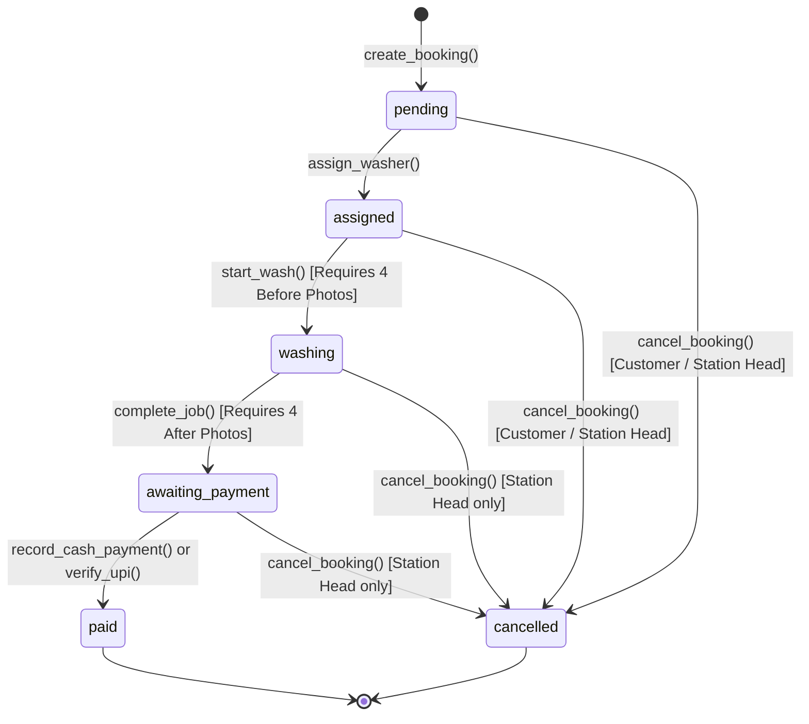

# 🚗 AppWasher — Complete Platform Specification & Backend Architecture

This document serves as the master blueprint, system architecture, database schema, and operational runbook for the **AppWasher** doorstep car-care platform.

---

## 1. Executive Summary & Live Deployments

**AppWasher** is a doorstep car-wash operations platform connecting car owners, washing station managers, and mobile field technicians in a unified real-time workflow.

* **Live Production URL (Next.js Root)**: [https://washer-2.vercel.app](https://washer-2.vercel.app)
* **Direct Standalone Distribution**: [https://washer-2.vercel.app/appwasher.html](https://washer-2.vercel.app/appwasher.html)
* **GitHub Repository**: [https://github.com/Chetan911n/washer-2.git](https://github.com/Chetan911n/washer-2.git) (Branch `main`)
* **Supabase Project Ref**: `jgekymuphznmfsbdexaw`

---

## 2. End-to-End Operational Lifecycle & State Machine

The platform enforces a strict unidirectional status machine at the database level:



### Business Rules Enforced in Database:
1. **Status Flow**: `pending` → `assigned` → `washing` → `awaiting_payment` → `paid`.
2. **Cancellation Boundaries**:
   * Customers can cancel **only before washing starts** (`pending` or `assigned`).
   * Station Heads can cancel anytime before the booking is `paid`.
   * Neither role can cancel a `paid` or already `cancelled` booking.
3. **Washer Capacity Guard**:
   * A washer can hold at most **2 active bookings** per date and slot.
   * Enforced in `assign_washer` and via `trg_enforce_washer_capacity` trigger.
4. **Mandatory Inspection Photos**:
   * `start_wash`: strictly requires all 4 before-wash photos (`front`, `rear`, `left`, `right`).
   * `complete_job`: strictly requires all 4 after-wash photos (`front`, `rear`, `left`, `right`).
5. **Direct Client Protection**:
   * Direct `UPDATE` permissions on `bookings`, `payments`, `photos`, and `settlements` are completely revoked from `anon` and `authenticated` roles.
   * State transitions must occur through `SECURITY DEFINER` database functions that validate role, station membership, and ownership.

---

## 3. Database Schema & Tables

All schema migrations are located under `supabase/migrations/`:
* `20261025000001_core_schema.sql` (13 core tables, indices, check constraints)
* `20261025000002_functions_and_triggers.sql` (Business logic, state machine, capacity checks)
* `20261025000003_rls_and_storage.sql` (Default-deny RLS, Storage bucket & policies, realtime)

### Table Inventory

| Table | Primary Key | Description & Key Constraints |
| :--- | :--- | :--- |
| `stations` | `id` (TEXT) | Washing hubs. Seeded: `green_valley` ("Green Valley Station", Hinjewadi, Pune). |
| `profiles` | `id` (UUID references `auth.users`) | Roles: `customer`, `station_head`, `washer`. Phone numbers unique. Role tampering blocked by trigger. |
| `cars` | `id` (TEXT) | Vehicles owned by customers. Types: `hatchback`, `sedan`, `suv`. |
| `parking_spots` | `id` (TEXT) | Customer service addresses and parking bay instructions. |
| `packages` | `id` (TEXT) | `ext` (Exterior Foam), `deep` (Deep Wash & Polish), `prem` (Premium Detail). |
| `package_prices` | `id` (UUID) | Flat prices per package & car type (ext: ₹499, deep: ₹799, prem: ₹1199). Configured in table, not code. |
| `bookings` | `id` (TEXT) | Human-readable code (`AW5246`). Date, slot (`06:30`, `08:30`, `15:00`, `17:00`), status, total INR. Partial unique index prevents double booking of spot at same slot. |
| `booking_cars` | `id` (UUID) | Snapshots `car_type_snapshot` and `price_inr_snapshot` at time of booking. |
| `photos` | `id` (UUID) | `kind` (`before`, `after`), `position` (`front`, `rear`, `left`, `right`, `existing_damage`). `UNIQUE(booking_id, kind, position)` ensures retake cleanly replaces photo. |
| `payments` | `id` (UUID) | `method` (`cash`, `upi`), `status` (`pending`, `confirmed`), confirmed timestamp. One confirmed payment per booking. |
| `reviews` | `id` (UUID) | `rating` (1-5), `tags` (text[]), `tip_inr` (>= 0). Unique per booking. |
| `settlements` | `id` (UUID) | Station remittance records tracking 20% platform fee settlements. |
| `settings` | `key` (TEXT) | Dynamic system configuration. Key `washer_slot_capacity = 2`. |

---

## 4. Row Level Security (RLS) Matrix

Every table has `ENABLE ROW LEVEL SECURITY` with default deny:

| Resource | Customer | Station Head | Field Washer |
| :--- | :--- | :--- | :--- |
| `profiles` | Read self | Read crew in station + booking clients | Read crew in station |
| `cars` | Full CRUD on own cars | Read cars on station bookings | Read cars on assigned bookings |
| `parking_spots` | Full CRUD on own spots | Read spots on station bookings | Read spots on assigned bookings |
| `packages` / `package_prices` | Read only | Read only | Read only |
| `bookings` | Read own bookings | Read station bookings | Read assigned bookings |
| `photos` | View inspection photos of own booking | View photos for station bookings | Upload / retake photos for assigned bookings |
| `storage.objects` (`booking-photos`) | Download signed URLs for own booking | Download signed URLs for station bookings | Upload photos to `{booking_id}/{kind}/{position}.jpg` |
| `settlements` | No access | Read / settle for own station | No access |

---

## 5. WhatsApp OTP Authentication Architecture

### Dual-Mode Architecture

The authentication layer is decoupled behind an adapter interface:

```
                      ┌──────────────────────┐
                      │    getOtpMode()      │
                      │  (Reads OTP_MODE)    │
                      └──────────┬───────────┘
                                 │
                 ┌───────────────┴───────────────┐
                 ▼                               ▼
       [ OTP_MODE = 'dev' ]             [ OTP_MODE = 'live' ]
       DevOtpProvider                   LiveWhatsAppOtpProvider
       ────────────────                 ────────────────────────
       • Seeded test numbers only       • Real WhatsApp phone numbers
       • Fixed code: 123456             • Meta Business Cloud API
       • DEV MODE visible badge         • Secure crypto 6-digit OTP
       • Quick Demo 1-click active      • Live approved template
       • Test numbers unusable in live  • Dev numbers refused
```

### Production Security Gate:
If `NODE_ENV === 'production'` and `OTP_MODE !== 'live'`, the app **refuses startup** immediately with a security exception.

### Rate Limits & Protection:
* **Expiry**: OTP codes expire after 5 minutes (300 seconds).
* **Cooldown**: 30-second waiting period before requesting a new code.
* **Phone Rate Limit**: Maximum 5 OTP requests per phone number per hour.
* **IP Rate Limit**: Maximum 20 OTP requests per IP per hour.
* **Lockout**: 5 consecutive incorrect code entries triggers an automatic **15-minute verification lockout**.
* **Privacy**: Phone numbers are masked (`+91******0001`) in all logs and client messages. Plain text numbers are never logged.

### Seeded Test Accounts (Development Mode):
| Persona | Name | Fake Test Phone | Test Code | Station |
| :--- | :--- | :--- | :--- | :--- |
| Customer | Chetan Sharma | `+910000000001` | `123456` | — |
| Station Head | Station Head (Vikram) | `+910000000002` | `123456` | Green Valley Station |
| Field Washer | Rajesh Kumar | `+910000000003` | `123456` | Green Valley Station |
| Field Washer | Suresh Verma | `+910000000004` | `123456` | Green Valley Station |
| Field Washer | Imran Khan | `+910000000005` | `123456` | Green Valley Station |

---

## 6. Storage & Camera Photo Capture

* **Storage Bucket**: `booking-photos` (private, access controlled via RLS).
* **Upload Path**: `{booking_id}/{kind}/{position}.jpg` (e.g. `AW5246/before/front.jpg`).
* **Camera Capture**: Integrated `<input type="file" accept="image/*" capture="environment" />` for native camera launching on mobile devices.
* **Retake Mechanism**: Selecting a new photo for a slot automatically overwrites the storage path and updates the database record.

---

## 7. Automated Test Suite

Run all tests locally or in CI with:
```bash
npm test
```

### Verified Test Results (44 Total Tests):
* **Suite 1: Auth & OTP Security (`tests/auth-otp.test.ts`)** — 25 Passed, 0 Failed:
  * Seeded phone receives dev OTP; fixed code `123456` verifies cleanly.
  * Non-seeded real phone rejected in dev mode.
  * Live adapter refuses seeded test numbers.
  * Startup refuses in production when `OTP_MODE != live`.
  * 30-second cooldown enforced.
  * 5 wrong codes triggers 15-minute lockout; locked account rejects further attempts.
* **Suite 2: Database & RLS Enforcement (`tests/database-rls.test.ts`)** — 19 Passed, 0 Failed:
  * Customer cannot alter own role (privilege escalation blocked).
  * `create_booking` validates ownership, snapshots flat package prices, generates `AWxxxx` ID.
  * State machine blocks illegal status transitions.
  * Station head can assign washer; customer cannot.
  * Washer capacity limit of 2 active bookings per slot strictly enforced.
  * `start_wash` blocked without 4 before-photos.
  * Customer cannot cancel booking once washing has started.
  * `complete_job` blocked without 4 after-photos.
  * Cash payment moves status to `paid`.
  * Customer review submission works for paid bookings.
  * Direct `UPDATE` denied on `public.bookings` for client roles.

---

## 8. Runbook: Switching from Dev Mode to Live Mode

To transition the platform to live WhatsApp messaging:

### Step 1: Complete Meta Business Verification
1. Open [Meta Business Suite](https://business.facebook.com/).
2. Submit your business documentation for Business Verification.
3. Once approved, create or link a WhatsApp Business Account (WABA).

### Step 2: Register & Approve OTP Template
1. In the WhatsApp Manager under **Account > Message Templates**, create an **Authentication** template:
   * **Template Name**: `appwasher_auth_otp`
   * **Category**: `Authentication`
   * **Language**: `en`
   * **Button**: One-tap autofill or copy code button.
2. Wait for Meta's automated approval (typically 2-15 minutes).

### Step 3: Configure Environment Variables
In your production environment (Vercel / Supabase Vault), set:
```bash
OTP_MODE=live
WHATSAPP_PHONE_NUMBER_ID="your_meta_phone_number_id"
WHATSAPP_ACCESS_TOKEN="your_system_user_permanent_token"
WHATSAPP_OTP_TEMPLATE_NAME="appwasher_auth_otp"
WHATSAPP_LANGUAGE_CODE="en"
```

No code changes are required. Changing `OTP_MODE=live` automatically activates `LiveWhatsAppOtpProvider`, disables dev shortcuts, removes the "DEV MODE" badge, and delivers real WhatsApp OTP messages.
